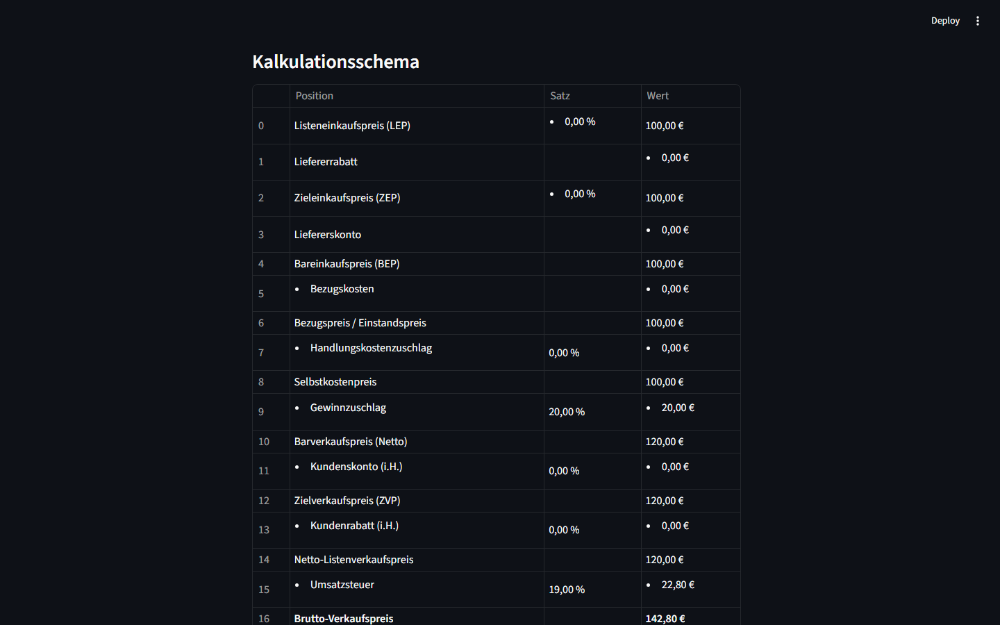
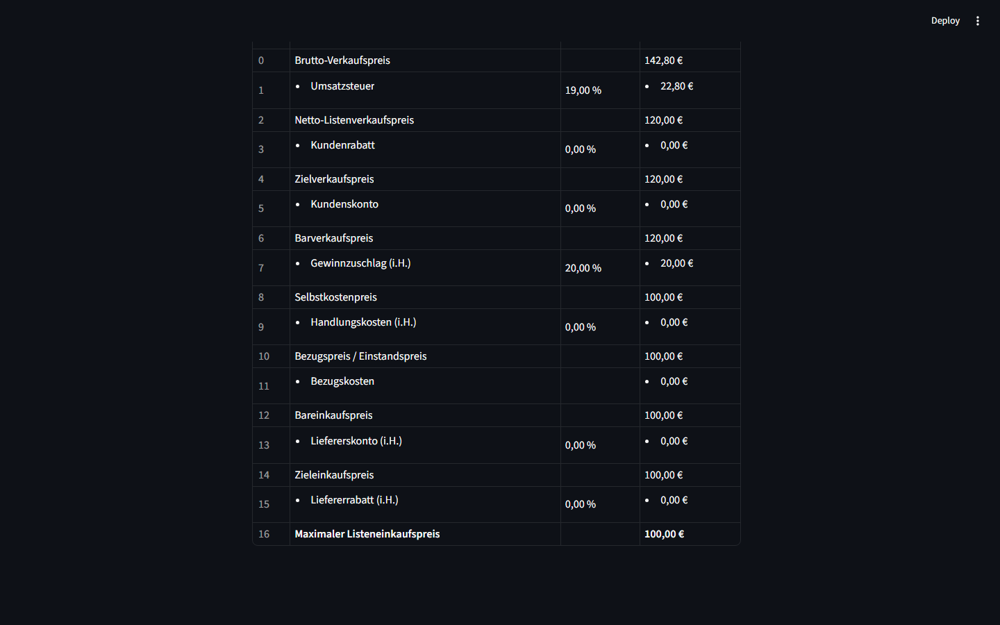
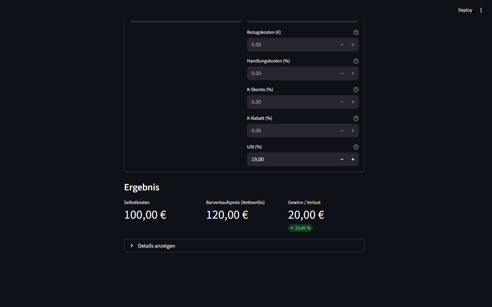

# KalkulationWebBased by JStudios

[-7656b5.svg)](https://jstudios.pages.dev/projects/kalkulation-webbased/)
[](https://www.python.org/)
[](https://streamlit.io/)
[](https://jstudios.pages.dev/projects/kalkulation-webbased/)
[](LICENSE)

**Handelskalkulation in drei Richtungen.**

[Projektseite](https://jstudios.pages.dev/projects/kalkulation-webbased/) · [Lizenz](LICENSE) · Lernwerkzeug

Interaktiver Rechner für Vorwärts-, Rückwärts- und Differenzkalkulation. Einkaufskonditionen, Bezugskosten, Handlungskosten, Gewinn, Kundenrabatt, Skonto und Umsatzsteuer werden im kaufmännischen Schema nachvollziehbar.

## Hintergrund

Die Anwendung macht das typische Handelskalkulationsschema als Lernwerkzeug unmittelbar nachvollziehbar. Je nachdem, ob Einkaufspreis, Verkaufspreis oder beide feststehen, beantwortet sie eine andere kaufmännische Fragestellung.

## Vorschau

### Vorwärtskalkulation



*Kalkulationsschema für einen fiktiven Einkauf.*

## Funktionsumfang

### Vorwärtskalkulation

Vom Listeneinkaufspreis über Rabatt, Skonto, Bezugskosten, Selbstkosten und Gewinn zum Bruttoverkaufspreis. Das Schema zeigt die Zwischenwerte.

### Rückwärtskalkulation

Aus dem vorgegebenen Bruttoverkaufspreis und den Konditionen rückwärts den möglichen Listeneinkaufspreis bestimmen.

### Differenzkalkulation

Sind Einkaufs- und Verkaufspreis vorgegeben, werden Selbstkosten, Nettoerlös und Gewinn beziehungsweise Verlust ermittelt.

### Kaufmännische Rundung

Zwischenergebnisse werden im implementierten Rundungsverfahren auf Cent dargestellt; Eingaben können sofort geändert werden.

## Beispiel und Bedienung

Bei 100 € Einkauf, 20 % Gewinnzuschlag, 19 % Umsatzsteuer und sonst null Konditionen ergeben sich 120 € Nettoverkaufspreis und 142,80 € brutto. Die Differenzkalkulation ergibt 20 € Gewinn beziehungsweise 20 % auf die Selbstkosten. Die Handelsspanne bezogen auf 120 € Nettoverkaufspreis beträgt 16,67 %. Der Beispielwert wurde per Streamlit AppTest geprüft.

1. **Richtung wählen:** Je nach Ausgangssituation Vorwärts-, Rückwärts- oder Differenzkalkulation auswählen.
2. **Konditionen eingeben:** Preise und Prozentwerte passend zum Beispiel setzen. Nicht eingegebene Werte werden als null behandelt.
3. **Schema nachvollziehen:** Zwischenergebnisse sowie Gewinn- und Spannenkennzahlen betrachten.

### Rückwärtskalkulation



*Verkaufsziel und rückwärts gerichtetes Kalkulationsschema.*

### Differenzkalkulation



*Gewinnermittlung für vorgegebene Ein- und Verkaufspreise.*

## Technische Eckdaten

Python · Streamlit · pandas

| Bereich | Beschreibung |
| --- | --- |
| Vorwärts | Einkauf → Verkauf |
| Rückwärts | Verkaufsziel → Einkauf |
| Differenz | Nettoerlös minus Selbstkosten |
| Gewinnzuschlag | Gewinn / Selbstkosten |
| Handelsspanne | Rohgewinn / Netto-Listenvk. gemäß Schema |

## Installation unter Windows

Python und pip installieren.

```powershell
git clone https://github.com/byJStudios/kalkulation-webbased.git
cd kalkulation-webbased
python -m venv .venv
.venv\Scripts\python.exe -m pip install -r requirements.txt
.venv\Scripts\python.exe -m streamlit run kalkulation.py --server.address 127.0.0.1
```

Alternativ das Repository als ZIP herunterladen und entpacken. Die lokale Browseradresse wird von Streamlit im Terminal angezeigt. Keine realen Daten in den Repository-Ordner einchecken.

## Projektstatus, Datenschutz und Grenzen

Lern- und Rechenwerkzeug, keine Steuer- oder Unternehmensberatung. Prozentwerte und Eingaben auf sinnvolle Grenzen prüfen; nicht alle Extremfälle sind validiert. Die gezeigten Eingaben sind fiktiv und wurden für die Vorschau voreingestellt.

## Lizenz

Eigener Quellcode wird ab diesem Lizenzwechsel unter der [PolyForm Noncommercial License 1.0.0](LICENSE) angeboten (Source-Available, nicht OSI-Open-Source). Frühere Veröffentlichungen werden nicht mehr angeboten; bereits wirksam erteilte Rechte bleiben unberührt.

Drittkomponenten behalten ihre jeweiligen Lizenzen: Streamlit (Apache-2.0), pandas (BSD-3-Clause). Sie werden separat installiert; die neue Lizenz beansprucht keine Rechte an Drittsoftware, Marken oder Inhalten Dritter. JStudios-Branding und eigene Gestaltungselemente sind nicht pauschal zur Nutzung freigegeben.

JStudios behält sich vor, Nutzungen außerhalb der jeweils geltenden Lizenz und gesetzlicher Erlaubnisse rechtlich zu verfolgen. Für gesonderte kommerzielle Nutzungsrechte: [jstudios.development@gmail.com](mailto:jstudios.development@gmail.com).

© 2026 Julian Schmitz / JStudios
